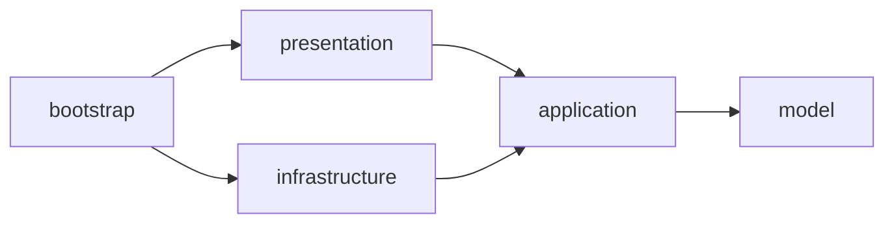

# Clean Architecture in Spring Boot Without the Excess Theory: JDBC, JPA, and Transactions

> **Dmitrii Russu** · Java Backend Developer
> Spring Boot · PostgreSQL/SQL · Kafka · Redis · Microservices
> *October 21, 2026*

---

Clean Architecture in Spring Boot is less about package structure and more about **the direction of dependencies** and **the boundary between the application and its infrastructure**.

Below is a small educational Spring Boot CRUD application ([code on GitHub](https://github.com/java-backend-architecture/clean-architecture)) that shows what these boundaries look like in practice:

- 📦 service and repository **interfaces are declared in the core** (`application`); service implementations also live in `application` (the `service` package), while repository adapters live in `infrastructure`;
- 🔌 **JDBC, jOOQ, or JPA** plug in as interchangeable adapters;
- 🚫 **transactions are kept out of the core**, which has no Spring dependencies;
- ✅ **ArchUnit and integration tests** verify that the boundaries hold.

The model is deliberately simple (`User`): the goal is to demonstrate the architecture and how to verify it, not to model a complex domain.

## Table of Contents

1. [The Idea](#the-idea)
2. [Structure and Models](#structure-and-models)
3. [Queries: Interfaces, Service, Adapter, Controller](#queries-interfaces-service-adapter-controller)
4. [ORM](#orm)
5. [Transactions](#transactions)
6. [Context Wiring](#context-wiring)
7. [ArchUnit Tests](#archunit-tests-protecting-the-architecture-from-erosion)
8. [Integration Tests](#integration-tests)
9. [What It Costs](#what-it-costs)
10. [Summary](#summary)

---

## The Idea

The common foundation of architectures built on dependency inversion (hexagonal, onion, and Clean Architecture) is **isolating the application core**. Java offers several techniques for this, and Spring itself imposes constraints (annotations, proxies, transactions).

**Technique 1. Abstract the service and the repository behind interfaces.**
Implementations depend on these interfaces, not the other way around. This lets you swap the repository implementation and test the core (business logic) independently of infrastructure. A plain DAO works the same way.

**Technique 2. Invert dependencies at the layer level.**
Move the interfaces into the business-logic layer (`application`). Now the core declares the interfaces, and the repository adapters in `infrastructure` implement them, not the other way around.

### Layer isolation rules

| # | Rule |
|---|------|
| 1 | `application`-layer services access storage through repository interfaces declared in `application`; the implementations live in `infrastructure`. |
| 2 | The core (`application`, `model`) has **no dependencies on Spring or JPA**. |
| 3 | Mapping between DTOs / persistence entities and the core's models happens **only outside the core** (in the presentation and infrastructure layers). |

These rules prevent infrastructure and presentation concerns from leaking into the core. ArchUnit tests enforce them.



> With `JdbcClient`, this is straightforward. ORMs and transactions complicate things somewhat. Code examples with explanations follow.

---

## Structure and Models

```java
public record User(String id, String name, LocalDate birthDate) {}
```

The repository provides full CRUD, and both the service interfaces (called *use cases* in the code) and the repository interfaces are split into **commands and queries**: reads return the read model `UserView`, writes accept `User`. For brevity, the article shows only the query side; the rest follows the same pattern.

For reads, we use the `UserView` projection instead of building the domain entity `User`. `UserView` is declared in `application` (the `usecase` package), while the domain model `User` is in `model`. JDBC maps the query result directly to the read model, and the JPA adapter converts the persistence entity into the same model. The repository interface in the application layer stays unchanged when the adapter is swapped.

---

## Queries: Interfaces, Service, Adapter, Controller

**Repository port** (`application`):

```java
public interface UserQueryRepository {
    Optional<UserView> findById(String id);
}
```

**Use case port** (`application`):

```java
public interface UserQueryUseCase {
    UserView findById(String id);
}
```

**Service** (`application`):

```java
@RequiredArgsConstructor
final class UserQueryService implements UserQueryUseCase {
    private final UserQueryRepository repo;

    @Override
    public UserView findById(String id) {
        return repo
                .findById(id)
                .orElseThrow(() -> new UserNotFoundException(id));
    }
}
```

**JDBC adapter** (`infrastructure`):

```java
@RequiredArgsConstructor
final class JdbcQueryRepository implements UserQueryRepository {
    private final JdbcClient client;

    @Override
    public Optional<UserView> findById(String id) {
        return client.sql(
                        SqlLoader.load("sql/query/select-by-id.sql")
                )
                .param("id", id)
                .query(UserView.class)
                .optional();
    }
}
```

**REST controller** (`presentation`):

```java
@RestController
@RequiredArgsConstructor
@RequestMapping("/api/users")
final class RestQueryController {
    private final UserQueryUseCase queryUseCase;

    @GetMapping("/{id}")
    @ResponseStatus(HttpStatus.OK)
    public UserResponse getDetails(@PathVariable String id) {
        return UserWebMapper.toResponse(queryUseCase.findById(id));
    }
}
```

---

## ORM

With an ORM, the annotated JPA entity lives in the `infrastructure` layer and is mapped there to the read model (`UserView`), which carries no Spring or JPA annotations.

```java
final class UserJpaMapper {

    private UserJpaMapper() {}

    static UserView toView(UserJpaEntity e) {
        return new UserView(e.id(), e.name(), e.birthDate());
    }
}
```

A JPA repository adapter is also needed:

```java
@RequiredArgsConstructor
final class JpaQueryRepository implements UserQueryRepository {
    private final UserJpaRepository jpa;

    @Override
    public Optional<UserView> findById(String id) {
        return jpa.findById(id).map(UserJpaMapper::toView);
    }
}
```

---

## Transactions

Putting `@Transactional` on services would make the core depend on Spring, so transaction boundaries are configured **outside the application layer using Spring AOP**. Commands get a regular transaction; queries get a read-only one.

```java
@Configuration
class TransactionConfig {

    @Bean
    @Role(BeanDefinition.ROLE_INFRASTRUCTURE)
    static Advisor commandTransactions(TransactionManager tm) {
        return advisor(UserCommandUseCase.class, tm, false);
    }

    @Bean
    @Role(BeanDefinition.ROLE_INFRASTRUCTURE)
    static Advisor queryTransactions(TransactionManager tm) {
        return advisor(UserQueryUseCase.class, tm, true);
    }

    private static Advisor advisor(
            Class<?> type, TransactionManager tm, boolean readOnly
    ) {

        var attribute = new DefaultTransactionAttribute();
        attribute.setReadOnly(readOnly);

        var source = new MatchAlwaysTransactionAttributeSource();
        source.setTransactionAttribute(attribute);

        return new DefaultPointcutAdvisor(
                new ComposablePointcut(
                        (ClassFilter) type::isAssignableFrom),
                new TransactionInterceptor(tm, source)
        );
    }
}
```

The pointcut selects classes that implement the service interface, and `MatchAlwaysTransactionAttributeSource` applies the same attributes (regular or read-only transaction) to all their methods.

> ⚠️ **The trade-off.** This approach requires an understanding of AOP, and the choice of proxy type is constrained. Service implementations are `final` classes, so **JDK dynamic proxies** are used. Spring Boot enables `proxy-target-class=true` by default, so `application.yml` sets it to `false` explicitly (`spring.aop.proxy-target-class: false`). CGLIB cannot proxy `final` classes, so switching back to `true` is not an option here. The test `useCasesAreTransactionalProxies` (see below) verifies that JDK proxies are actually in use.

---

## Context Wiring

The configuration restricts scanning to the service layer and the selected adapter, registering only implementations of the specified interfaces. The adapter is switched with a single constant (`ADAPTER`: JDBC, jOOQ, or JPA), and the core code does not change. Package-private adapter classes prevent direct access to them from other packages.

```java
@Configuration
@ComponentScan(
        basePackages = {
                "dev.dmitriirussu.clean.architecture.application.service",
                AdapterWiringConfig.ADAPTER
        },
        useDefaultFilters = false,
        includeFilters = @ComponentScan.Filter(
                type = FilterType.ASSIGNABLE_TYPE,
                classes = {
                        UserCommandUseCase.class,
                        UserQueryUseCase.class,
                        UserCommandRepository.class,
                        UserQueryRepository.class
                }
        )
)
class AdapterWiringConfig {

    private static final String BASE = "dev.dmitriirussu.clean.architecture.infrastructure.";

    static final String JDBC = BASE + "jdbc";
    static final String JOOQ = BASE + "jooq";
    static final String JPA  = BASE + "jpa";

    static final String ADAPTER = JDBC;
}
```

Services and adapters carry no Spring annotations (the core knows nothing about Spring), so regular component scanning doesn't see them. This configuration registers them itself: with `useDefaultFilters = false`, classes implementing the listed interfaces are added to the context even if they are package-private and have no `@Component`. Controllers and configuration classes are picked up by regular scanning, since the main class `CleanArchitectureApplication`, annotated with `@SpringBootApplication`, sits in the root package.

### A note on dependencies in `pom.xml`

The educational repository includes the starters for all three adapters (JDBC, jOOQ, Spring Data JPA) so that you can switch adapters without touching the build. **In a real project you need only one.** Remove the other starters from `pom.xml`; otherwise Spring Boot's auto-configuration may start unnecessary infrastructure (for example, JPA when JDBC is selected).

### Isolation: package-private vs. modules

Because the example lives in a single Maven module, package-private visibility protects adapter implementations from direct use, but it does not prevent every possible compile-time dependency between the layers' public types. ArchUnit covers those.

For full compiler-enforced isolation, split the application into modules (Maven or JPMS): an illegal dependency then simply won't be on the module's classpath. The README describes such a split:

- `model`
- `application`
- `infrastructure-jdbc`, `infrastructure-jooq`, `infrastructure-jpa`
- `presentation-rest`, `presentation-mvc`
- `app` (assembly module)

Switching adapters then comes down to changing a dependency in the `app` module's `pom.xml`. This example deliberately does not implement that split.

### Are the services just empty wrappers?

For now, the services mostly just delegate to the repository, but they are not empty wrappers: the service interface is **the single entry point for controllers** and **the transaction boundary** to which the advisor is applied.

Separate unit tests for services are not shown here, as they contain no business rules of their own. The application's behavior, including handling of a missing user, is verified at the API level. Once non-trivial rules appear, it would make sense to test them separately from Spring and the database.

---

## ArchUnit Tests: Protecting the Architecture from Erosion

Architecture tests verify the direction of dependencies between layers: no Spring or JPA in the core, no dependencies from the model or service layer on outer layers, and no direct dependencies between presentation and infrastructure. This is a specific set of forbidden dependencies; add new rules as needed.

```java
class ArchitectureTest {

    private static final JavaClasses CLASSES =
            new ClassFileImporter()
                    .withImportOption(new ImportOption.DoNotIncludeTests())
                    .importPackages("dev.dmitriirussu.clean.architecture");

    @Test
    void coreHasNoSpring() {
        noClasses().that().resideInAnyPackage(
                        "..application..", "..model.."
                )
                .should()
                .dependOnClassesThat()
                .resideInAPackage("org.springframework..")
                .check(CLASSES);
    }

    @Test
    void coreHasNoJpa() {
        noClasses()
                .that()
                .resideInAnyPackage("..application..", "..model..")
                .should()
                .dependOnClassesThat()
                .resideInAnyPackage(
                        "jakarta.persistence..", "org.hibernate.."
                )
                .check(CLASSES);
    }

    @Test
    void modelDoesNotDependOnOuterLayers() {
        noClasses()
                .that()
                .resideInAPackage("..model..")
                .should()
                .dependOnClassesThat()
                .resideInAnyPackage(
                        "..application..",
                        "..infrastructure..",
                        "..presentation..",
                        "..bootstrap.."
                )
                .check(CLASSES);
    }

    @Test
    void applicationDoesNotDependOnOuterLayers() {
        noClasses()
                .that()
                .resideInAPackage("..application..")
                .should()
                .dependOnClassesThat()
                .resideInAnyPackage(
                        "..infrastructure..",
                        "..presentation..",
                        "..bootstrap.."
                )
                .check(CLASSES);
    }

    @Test
    void presentationDoesNotDependOnInfrastructure() {
        noClasses()
                .that()
                .resideInAPackage("..presentation..")
                .should()
                .dependOnClassesThat()
                .resideInAPackage("..infrastructure..")
                .check(CLASSES);
    }

    @Test
    void infrastructureDoesNotDependOnPresentation() {
        noClasses()
                .that()
                .resideInAPackage("..infrastructure..")
                .should()
                .dependOnClassesThat()
                .resideInAPackage("..presentation..")
                .check(CLASSES);
    }
}
```

---

## Integration Tests

These verify the Spring configuration: the context starts successfully, there is exactly one implementation of each service and repository interface, and JDK dynamic proxies are created for the service interfaces.

```java
@SpringBootTest
class CleanArchitectureApplicationTests {

    @Autowired
    ApplicationContext ctx;

    @Test
    void portsAreWired() {

        assertThat(
                ctx.getBeansOfType(UserQueryRepository.class)
        )
                .hasSize(1);

        assertThat(
                ctx.getBeansOfType(UserCommandRepository.class)
        )
                .hasSize(1);

        assertThat(
                ctx.getBeansOfType(UserCommandUseCase.class)
        )
                .hasSize(1);

        assertThat(
                ctx.getBeansOfType(UserQueryUseCase.class)
        )
                .hasSize(1);
    }

    @Test
    void useCasesAreTransactionalProxies() {

        assertThat(
                AopUtils.isJdkDynamicProxy(
                        ctx.getBean(UserCommandUseCase.class))).isTrue();

        assertThat(
                AopUtils.isJdkDynamicProxy(
                        ctx.getBean(UserQueryUseCase.class))).isTrue();
    }
}
```

Behavior is verified by the end-to-end `UserApiTest` through REST: reading, a 404 response for a missing user, creation, update, and deletion. The same suite passes on every adapter: after switching the `ADAPTER` constant, you just rerun it, which also confirms that the adapters are interchangeable.

---

## What It Costs

A plain DAO behind an interface also makes storage replaceable, so that is not the point. What matters here is that:

- the interfaces are declared in the application layer,
- the core contains no Spring or JPA types or annotations (including `@Transactional`),
- tests enforce the direction of dependencies.

Compared with a typical layered Spring application (a service with `@Transactional` and a Spring Data repository), this approach adds service interfaces, two configuration classes (AOP-based transactions and package scanning), and ArchUnit tests. The least familiar addition is AOP-based transactions, which require an understanding of proxies (see the [Transactions](#transactions) section). With `JdbcClient` and SQL, there are no additional mappings: query results go straight into the read model, and on writes the parameters are taken directly from `User`.

With an ORM, the cost is higher and grows with the number of entities, since each one needs its own mapper and repository adapter (the JPA entity stays in `infrastructure`). If you use an ORM and only need a minimally working version, consider whether this level of isolation is worth it.

> 💡 Establishing these boundaries at the start is cheaper than cutting them out of a finished application later: the longer the code lives, the more places where Spring and JPA types have leaked into services and controllers, and each one has to be found and fixed by hand. Testing from day one keeps such leaks from accumulating and turns the boundaries from a convention into a rule.

---

## Summary

The example demonstrates the shared principles of Clean, Onion, and Hexagonal Architecture:

1. dependencies point inward;
2. the core does not depend on Spring;
3. infrastructure adapters implement interfaces declared in the core;
4. architecture tests verify that the defined boundaries are respected.

The full example, with tests and several implementations (JdbcClient, jOOQ, JPA; REST and server-side HTML with jte), is on GitHub:

👉 **<https://github.com/java-backend-architecture/clean-architecture>**
